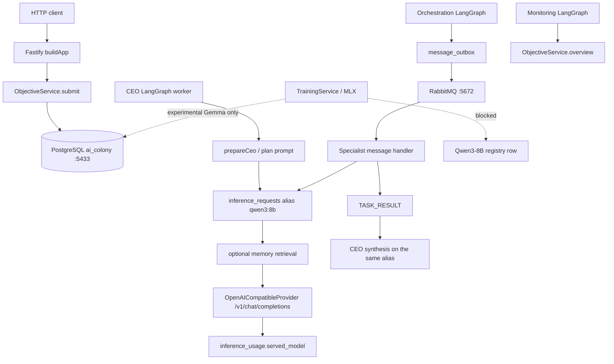

# M8 — Architecture and Runtime Audit

Audit date: 2026-11-02. Read-only. No source files other than this report were written. No schema migration, database write, training run, model download, deployment, or service restart was performed. PostgreSQL port 5434 was not contacted. At audit time nothing was listening on 5434.

Evidence labels used below:

- **Verified by code inspection** — the source implements the behavior. This is not proof that it is running.
- **Verified by existing test evidence** — a test in the repository asserts the behavior. This audit did not re-run the suite.
- **Verified by read-only runtime inspection** — observed from processes, files, or `SELECT` on `127.0.0.1:5433`.
- **Reported but not verified** — stated in docs or prior milestones and not re-checked here.
- **Unknown** — not determined.

## 1. Executive summary

The control plane is a real TypeScript system: Fastify routes, a department and agent registry, LangGraph workers for planning and monitoring, RabbitMQ outbox messaging, scoped memory, and a governed training path that refuses to replace Qwen. What is running today is much smaller than that registry.

On 2026-11-02 the API is not listening, the LangGraph workers are not running, and Ollama is not running. RabbitMQ is listening on `127.0.0.1:5672` through Docker. Homebrew PostgreSQL 17.5 is listening on `127.0.0.1:5433`, database `ai_colony`, with its data directory at `/tmp/ai-colony-pg`. The last worker heartbeats and the last completed inferences are from 2026-11-01. `model_runtimes` still says Qwen3-8B is `ready`. That row is stale.

The shared-model assumption is confirmed for the inference path that has actually run. All 21 completed inference requests asked for alias `qwen3:8b`, and all 21 usage rows record served model `qwen3:8b`. Agent rows that name Qwen3-4B or Gemma 3 270M are identities, not separate loaded networks. `department_model_assignments` has two rows (Math and Science, `shared_base`, Qwen3-8B, no adapter). The chat router does not read that table.

Departmental memory is implemented and has been written: 20 memory rows and 15 retrieval events. The contents are milestone and demonstration records (`M7-VERIFIED-FACT`, `JOINT-MU-…`, a gravitational-constant string), not a growing operational knowledge base. Nothing in the current process list is writing memory now.

Independent departmental adapters are not serving. The Ollama chat call sends a model alias and no adapter. Adapter load, promotion, and rollback exist for an experimental Gemma route and are blocked from changing the Qwen production row. Weight training is not running.

Do not start M9 on the current evaluation tables. Those tables record a different harness (`maxTokens: 8`, base hash prefix `0e2acba196efd538`) from the M7.5 file artifacts (32-token versus 128-token Qwen3-1.7B runs). A ledger built on the tables as they stand would mix incompatible measurements. The comparison contract, a topic taxonomy, and a live model-status probe are prerequisites.

## 2. Verified architecture

### Workspace

**Verified by code inspection.** pnpm workspace, Node `>=22 <23`, package manager `pnpm@10.18.2` (`package.json`).

| Package | Role |
| --- | --- |
| `apps/api` | Fastify HTTP control plane. Entry `apps/api/src/server.ts`, composition `buildApp` in `apps/api/src/app.ts`. |
| `packages/contracts` | Zod schemas and ids, including `QWEN3_8B_MODEL_ID`. |
| `packages/core` | Departments, agents, objectives, memory, governance, training, evaluation, learning. |
| `packages/database` | Drizzle schema, migrations `0000`–`0008`, seed, immutability SQL in `packages/database/src/migrate.ts`. |
| `packages/inference` | OpenAI-compatible client aimed at local Ollama, plus embedding client. |
| `packages/messaging` | Transactional outbox publisher and RabbitMQ consumer. |
| `packages/workflows` | LangGraph workers. |
| `services/training` | Python MLX-LM LoRA worker and research artifacts. Not on the chat path. |
| `research/m75`, `research/m75b`, `research/m75c` | Offline arithmetic experiments. Not invoked by the API. |

Scripts: `dev`, `dev:publisher`, `dev:consumer`, `dev:ceo`, `dev:orchestration`, `dev:specialists`, `dev:monitoring`. There is no Engineering worker and no per-department model process.

### What was listening

**Verified by read-only runtime inspection.**

| Port | Process | State |
| --- | --- | --- |
| 5433 | `/opt/homebrew/Cellar/postgresql@17/17.5/bin/postgres -D /tmp/ai-colony-pg -p 5433` | Listening. Database `ai_colony`. |
| 5432 | Another local `postgres` | Listening. Not queried. |
| 5434 | — | Not listening. Not contacted. |
| 5672, 15672 | Docker (`com.docke`) | RabbitMQ listening on localhost. |
| 3000 | — | API not listening. |
| 11434 | — | Ollama not listening. `ollama list` and `GET /api/ps` failed with a connection error. |

Weights for `qwen3:8b` are on disk under `~/.ollama/models/manifests/registry.ollama.ai/library/qwen3/8b`. The model layer size in that manifest is 5,225,374,496 bytes. `embeddinggemma` is also on disk. Neither is loaded, because the server is down.

### Request path

**Verified by code inspection** unless noted.

1. `ObjectiveService.submit` (`packages/core/src/objectives/objective-service.ts`) inserts an objective. Execution is authorized only when the caller role has `objective:execute`. The row stores `primaryModelId` as the Qwen3-8B id and `operationalModelId` as the Qwen3-4B id. Those columns are labels. They do not start a process.
2. The CEO graph (`compileCeoGraph` in `packages/workflows/src/graphs.ts`) calls `prepareCeo`, then `executePrepared` (`packages/workflows/src/runtime.ts`).
3. `modelChoice` in `objective-service.ts` returns alias `route.alias` from `INFERENCE_MODEL_ALIAS` (default `qwen3:8b`) for plan, correct, specialist, and synthesis. The 4B alias is used only when `INFERENCE_MEMORY_PROFILE=split`, the purpose is `monitor`, and `INFERENCE_OPERATIONAL_ALIAS` is set. The default profile is `shared` (`packages/inference/src/config.ts`).
4. `executePrepared` may prepend retrieved memory, then calls `OpenAICompatibleProvider.generate`. The body is `{ model: request.modelAlias, messages, temperature, max_tokens }`. There is no adapter field (`packages/inference/src/openai.ts`). `reasoning_effort: "none"` is sent so Qwen3 thinking stays off, with a retry that drops the field if the server rejects it.
5. The provider rejects a response whose `model` field differs from the requested alias.
6. Orchestration (`compileOrchestrationGraph`) schedules tasks and publishes `TASK_REQUEST` through the outbox. The publisher is a separate process (`packages/messaging/src/publisher-cli.ts`).
7. Specialists are not a LangGraph. `objectiveMessageHandler` with `role: "specialist"` claims the task and calls the same `executePrepared` path. Eligible departments are only `math`, `science`, `research`, and `reasoning`.
8. Monitoring (`compileMonitoringGraph`) reads overview findings and can publish alerts. It does not call the model unless recovery scheduling is enabled.

**Verified by read-only runtime inspection.** 21 completed inference requests, all `requested_alias = qwen3:8b`, purposes `specialist` (10), `plan` (4), `correct` (4), `synthesize` (3). `inference_usage` has 21 rows, `served_model = qwen3:8b`, token source `observed`, average output about 468 tokens, average latency about 11.8 seconds. Timestamps are 2026-11-01 01:12–01:47. Four objective runs exist (3 completed, 1 failed). Worker heartbeats for `ceo`, `orchestration`, `specialist`, and `monitoring` stop the same morning. No worker process is running now.

`message_outbox` has 20 rows still `pending`. The broker is up. The publisher process is not, so those rows are not moving.

### Component notes

| Component | Source | Intended | Actual | Execution evidence | Gap |
| --- | --- | --- | --- | --- | --- |
| Department registry | `DepartmentService`, seed `INITIAL_DEPARTMENTS` | 12 system departments | 13 rows: the seed plus Engineering `proposed` / `specialized` / `creation_source = api` | **Runtime:** the 13 rows | Engineering has no agent |
| Agent lifecycle | `AgentService`, `AgentRuntime` | Start, stop, heartbeat | Founding agents are `idle`. Heartbeat table is historical | **Runtime:** last beats 2026-11-01 | Workers are down |
| LangGraph | `packages/workflows/src/graphs.ts` | CEO, orchestration, monitoring, learning resume | Those four graphs exist. Specialists are a consumer | **Runtime:** heartbeats for three worker roles, not a live graph | Learning graph is a one-step `resume`, not a trainer |
| RabbitMQ | `rabbitmq-transport.ts`, outbox | Publish and consume | Broker listening. 20 outbox rows pending | **Runtime:** ports 5672 and 15672 | Publisher and consumers are down |
| Ollama | `OpenAICompatibleProvider` | One local alias | Weights on disk. Server down | **Runtime:** connection refused; `model_runtimes` still `ready` from 2026-11-01 01:14 | Stale ready flag |
| Training | `TrainingService`, `services/training` | Isolated LoRA | Code refuses to relabel Qwen. Default API provider is the scripted provider unless `TRAINING_PROVIDER=mlx` | **Runtime:** 21 `training_experiments` rows, all recommendations other than promote | Not running. Research runs are files, not this API |
| Governance | `Authorizer`, approval service, SQL triggers | RBAC plus append-only audit | Role checks throw when the permission is absent. Triggers are installed | **Runtime:** 19 triggers. **Test:** `tests/integration/models-audit.test.ts` | Several mutable tables have no trigger. See section 7 |

## 3. Department model assignment matrix

Registry status for every model row is `not_deployed`, `deployment_target = none`, `artifact_uri` null. **Verified by read-only runtime inspection.** The only `model_runtimes` row is Qwen3-8B, `runtime_status = ready`, `expected_alias = qwen3:8b`, `loaded_model_id = qwen3:8b`, probed 2026-11-01 01:14. Ollama is not running now, so nothing is loaded. **Verified by read-only runtime inspection.**

Agent `model_id` is not read by `modelChoice`. **Verified by code inspection.** Completed requests did not follow the 4B or Gemma agent ids. **Verified by read-only runtime inspection.**

| Department | Status | Agent | Agent registry model | Assignment table | What inference uses | Adapter loaded |
| --- | --- | --- | --- | --- | --- | --- |
| CEO | active, seed | CEO, idle, `ceo_agent` | Qwen3-8B | none | `qwen3:8b` when a plan or synthesis runs | no |
| Orchestration | active, seed | Orchestration, idle | Qwen3-4B | none | `qwen3:8b` on the shared profile | no |
| Monitoring | active, seed | Monitoring, idle | Qwen3-4B | none | 4B only if profile is `split` and purpose is `monitor`. Default is shared 8B. No `monitor` inference row exists | no |
| Math | active, seed | Math, idle | Qwen3-8B | `shared_base`, active, Qwen3-8B, version 1, no adapter | `qwen3:8b`. The assignment row is not consulted | no |
| Science | active, seed | Science, idle | Qwen3-8B | `shared_base`, active, Qwen3-8B, version 1, no adapter | same as Math | no |
| Research | active, seed | Research, idle | Qwen3-8B | none | `qwen3:8b` | no |
| Reasoning | active, seed | Reasoning, idle | Qwen3-8B | none | `qwen3:8b` | no |
| Weight Optimization | active, seed | Weight Optimization, idle | Gemma 3 270M | none | Chat path does not use this id. Experimental Gemma route is separate | no |
| Evaluation | active, seed | Evaluation, idle | Gemma 3 270M | none | Chat path does not use this id | no |
| Memory & Forgetting | active, seed | Memory & Forgetting, idle | Qwen3-8B | none | `qwen3:8b` if that agent were invoked on the objective path. It is not a specialist slug | no |
| Evolution | active, seed | none | — | none | no inference identity | no |
| Gaming | active, seed | none | — | none | no inference identity | no |
| Engineering | proposed, created by API | none | — | none | no inference identity | no |

System prompts are shared templates in `packages/core/src/objectives/prompts.ts`: one planner prompt, one specialist prompt with an extra sentence for research, one synthesis prompt. They are not per-department documents. The research sentence tells the model that no external tools are configured. **Verified by code inspection.**

Department tools are not attached to chat. `DepartmentLearningService.executeTool` allows `exact_arithmetic` only after a capability approval, and it evaluates integer addition in process. It does not call Ollama. Math has capability `exact-addition` versions `proposed` and `approved`. **Verified by code inspection and runtime rows.**

`agents.adapter_version` is null on every founding agent. **Verified by read-only runtime inspection.**

Training of an isolated adapter is the Gemma experimental path (`TrainingService.promote` throws `PRODUCTION_MODEL_ISOLATED` when the trainable model is Qwen3-8B or the family is not `gemma-3`). A successful promotion updates the candidate status and writes an audit event with `productionRoutingUnchanged: true`. It does not change the Qwen row. **Verified by code inspection.** The historical MLX arithmetic runs wrote adapter files under `services/training/research-artifacts` and did not deploy them. **Reported by the Phase 1A report and the experiment rows; the files were not re-hashed in this audit.**

## 4. Departmental memory assessment

Storage is `memories` plus revisions, embeddings, promotions, retrieval events, contradictions, and forgetting requests. Scope is `agent`, `department`, or `colony`. Read rules are in `canReadMemory` (`packages/core/src/memory/access.ts`): an agent sees its own agent-scope rows, its department sees department-scope rows, colony-scope requires `memory:read:colony`, and `memory:admin` bypasses those checks. A write of department scope by another department is rejected in `MemoryService`. **Verified by code inspection.**

Retrieval is connected to inference. `createObjectiveMemory` searches with the specialist or CEO actor, and `executePrepared` prepends a `<memory>` block when the search returns text. Errors are swallowed and the call proceeds without memory. **Verified by code inspection.** The inference row does not record whether a block was inserted, so insertion into the 21 completed calls is **Unknown** per request. Fifteen `memory_retrieval_events` and nineteen `memory_embeddings` exist, so retrieval has run. **Verified by read-only runtime inspection.**

Provenance is a column. Status is a column (`candidate`, `forgotten`, and others in the schema). Confidence is not a column. The prompt renderer hard-codes `quality=uncalibrated`. **Verified by code inspection and the column list.**

Forgetting is a request workflow: Memory & Forgetting proposes, Evaluation records the request, and a forgotten row can have its content cleared. One agent-scope row is `forgotten` with empty content. Retention policies and promotion requests exist as tables. This audit did not see a scheduler applying retention. **Verified by code inspection for the workflow; runtime shows one forgotten row.**

Counts on 5433, 20 rows total:

| Department | Scope | Provenance | Rows |
| --- | --- | --- | ---: |
| CEO | agent | model_generated | 4 |
| Math | agent | model_generated | 2 |
| Math | department | user_provided | 2 |
| Science | agent | model_generated | 3 |
| Science | department | user_provided | 3 |
| Research | agent | model_generated | 3 |
| Research | agent | user_provided | 1 |
| Evaluation | agent | user_provided | 1 |
| Monitoring | agent | system_observed | 1 |

Recent titles and bodies include `M7-VERIFIED-FACT`, `M7-UNVERIFIED model guess`, `JOINT-MU-1793549671514`, and `G=6.67430e-11`. These are demonstration records from 2026-11-01. No department is continuously accumulating knowledge. **Verified by read-only runtime inspection.**

There is no topic taxonomy or knowledge-graph table. The closest structures are capability `domain` / `task_type` and memory category. **Verified by code inspection of the schema.**

Cross-department memory is blocked for ordinary reads. It is allowed when a promotion moves a row to colony scope, or when a knowledge-transfer flow copies a memory after validation (`DepartmentLearningService.transferKnowledge`). Direct message delivery across departments is explicitly allowed and does not grant the sender the recipient's memory permission (`crossDepartmentDeliveryAllowed`). **Verified by code inspection.**

## 5. Learning pipeline assessment

Weight training is not running. The last training heartbeat is `training` / `training` at 2026-11-01 10:51. **Verified by read-only runtime inspection.**

| Step | Status | Evidence |
| --- | --- | --- |
| Learning request | Implemented. Four `learning_cycles` rows exist (`ADOPTED`, `REJECTED`, two `CANCELLED`), all on 2026-11-01 around the memory-demo timestamps | Code: `DepartmentLearningService`. Runtime: those four rows. Whether they were API demos or tests against this database is not separately labeled |
| Authorization | Implemented. `Authorizer.assert` denies a role that lacks the permission. Weight Optimization's role is `department_agent`, which can propose and create datasets. It does not have `training:execute`, `model:candidate:promote`, or `learning:approve`. CEO does not have those either. Permanent approval is `system_administrator` only | **Code.** **Test evidence** exists for governance. Not re-run |
| Training preparation | Implemented: datasets, examples, trainable models, experiment planner. `training_experiments` has 21 rows (16 `lora-supervised` / answer, 3 `verified-rejection-sft` / answer, 2 `structured-solution-sft` / structured). Every row's recommendation is other than promote. 15 have an adapter hash | **Code and runtime** |
| Training execution | Implemented behind `TRAINING_PROVIDER=mlx` and an explicit execute call. The API default is `ScriptedTrainingProvider`. No job is running. Research scripts under `research/m75*` are manual | **Code.** Runtime: not running |
| Automatic trigger | Not implemented. Nothing in the workers starts an optimizer when a gap is observed. `compileLearningGraph` only calls `resume` | **Code** |
| Data validation | Implemented for the colony trainer (dataset version, example immutability trigger). The M7.5 research sets are files outside those tables | **Code and trigger list** |
| Isolated adapters | Implemented for Gemma. Qwen training in the research tree writes adapter files and does not assign them | **Code.** Runtime: assignment adapter hashes are null |
| Shared base protected | Implemented. Promote and assign throw if the Qwen row would change. Qwen `artifact_uri` is still null and status is still `not_deployed` | **Code and runtime** |
| Department assignment of an adapter | The table can store `candidate_id` and `adapter_sha256`. The chat router ignores the table. Current rows have no adapter | **Code and runtime** |
| Automatic evaluation | A cycle can call `evaluateCycle` when something invokes it. Workers do not poll for that. Colony `evaluation_runs`: 3 `live`, 2 `historical`, decoding `maxTokens: 8` | **Code and runtime** |
| Promotion gate | Implemented. Promotion requires a passing held-out evaluation and a different actor from the creator. It still does not switch Ollama | **Code** |
| Rollback | Implemented for `experimental_routes`. One `rollback_requests` row is `completed`, version 2 back to version 1, on route `m6-experimental` (Gemma candidate and baseline, base hash prefix `0e2acba196ef`) | **Code and runtime.** This did not change Ollama, which has no adapter loaded |

Weight Optimization does not generate an executable plan by itself in the live system. `ExperimentService` and `experiment-planner.ts` can record a plan. Monitoring can stop an experiment. Weight Optimization cannot approve it. **Verified by code inspection** of `ROLE_PERMISSIONS` and `apps/api/src/app.ts`. The 21 experiment rows show plans that were recorded after the research runs, with non-promote recommendations. **Verified by read-only runtime inspection.**

## 6. Evaluation system assessment

Two evaluation systems exist. They do not share a comparison key.

### Colony tables

`benchmark_suites` 4, `benchmark_versions` 4, `benchmark_items` 45, `evaluation_runs` 5, `evaluation_item_results` 100, `evaluation_reports` 5. **Verified by read-only runtime inspection.**

Each run stores `benchmark_version_id`, `candidate_id`, `trainable_model_id`, `base_sha256`, optional `adapter_sha256`, `source` (`live` or `historical`), and `decoding`. All five stored decodings are `{"strategy":"greedy","maxTokens":8,"temperature":0}`. All five base hashes start with `0e2acba196efd538`. All five have an adapter hash. Item rows store raw output, `task_correct`, `format_valid`, `strict_integer_match`, `ambiguous`, and `equation_value`. Baseline items: 12/50 correct, 21 format failures. Candidate items: 4/50 correct, 24 format failures. **Verified by read-only runtime inspection.**

The scorer in `packages/core/src/evaluation/stats.ts` computes a Wilson interval and an exact McNemar p-value. Gate policy is hashed onto `candidate_gate_decisions`. **Verified by code inspection.** This audit did not recompute those p-values from the 100 item rows.

Not stored on these rows: thinking mode, a separate prompt-template hash (the item has `prompt_hash`), token-limit as a first-class comparison dimension beyond the JSON blob, truncation, retrieval configuration, tool configuration, department id, or the Ollama alias. Format failure is stored. Truncation is not.

### Research artifacts

M7.5, M7.5B, and M7.5C Phase 1A live under `services/training/results/`. Phase 1A (`services/training/results/m75c/phase1a/REPORT.md`) records that the historical base score of 134/300 was a 32-token cap with 212 truncations, and that the same base and prompt at 128 tokens scored 291/300. Those generations are JSONL files with `maxTokens`, `finishReason`, seed, and the closed think block. They are not rows in `evaluation_runs`.

A fair comparison is possible inside one of those file sets when the prompt, token cap, think setting, and decoder match. A comparison between the 32-token score and the 128-token score is a token-budget change, which Phase 1A already separated. A comparison between those files and the colony `evaluation_runs` is not valid: the colony runs use `maxTokens: 8` and a different base hash, on the Gemma experimental route rather than Qwen3-1.7B. **Verified by code inspection of the report and by the decoding values in the database.**

This audit did not rerun benchmarks.

## 7. Governance and security findings

| Control | Finding | Label |
| --- | --- | --- |
| Department permissions | `ROLE_PERMISSIONS` is the source of grants. `department_agent` cannot approve budgets, promote candidates, or execute training | Code |
| CEO limits | CEO can decide temporary approvals (`approval:decide`) and cannot decide permanent ones (`approval:decide:permanent` is not in the CEO set). CEO cannot promote a model | Code. `assertCanCreateDepartment` rejects `system` departments unless the actor is `system_administrator` |
| Permanent vs temporary | Seed departments are `department_type = system`. Engineering is `specialized` and still `proposed`. Permanent activation requires the system administrator | Code and runtime |
| Deployment authorization | Model status changes go through services that check permissions. No model is `available`. Runtime `ready` was written by a probe, not by a promotion | Runtime |
| Training authorization | `training:execute` is not granted to CEO or department agents. The system administrator has every permission | Code |
| Cross-department messages | Allowed on purpose. The message does not copy permissions | Code |
| Memory access | Enforced in application code by scope. Not enforced by a row-level security policy | Code. No RLS policies were queried; none appear in the migrations that were read |
| Audit immutability | Triggers `audit_events_no_update` and `audit_events_no_delete` are installed. The integration test expects `append-only` on update and delete | Runtime triggers. Existing test `tests/integration/models-audit.test.ts`. Not re-run, and not run against this database |
| Other immutability | Triggers also cover training examples, benchmark items, evaluation item results, learning cycle events, training experiments, and several decision tables. See the appendix | Runtime |
| Fail-closed | `Authorizer.assert` throws `AUTHORIZATION_DENIED` when the role set lacks the permission. An unknown role is not a successful empty grant: `ROLE_PERMISSIONS[actor.role]` would be undefined and the call would throw. Missing actor on a route is the auth plugin's job. `AUTH_MODE=development` in `.env.example` trusts a Bearer principal id. This audit did not inspect a live auth failure because the API is down | Code. Live auth behavior **Unknown** while the API is stopped |
| Application permission without a database trigger | `memories`, `messages`, `models`, `agents`, `department_model_assignments`, `inference_requests`, and `model_runtimes` can be updated by any database role that has SQL access. The colony role used by the app is that role. Immutability of audit and evaluation rows does not extend to model assignment or memory | Code plus the trigger list |

This audit did not attempt writes to prove the triggers. The trigger definitions were listed from `information_schema.triggers`.

## 8. Infrastructure and resource requirements

Local, today:

- Homebrew PostgreSQL on 5433, data directory `/tmp/ai-colony-pg`. A reboot that clears `/tmp` would drop this cluster. **Verified by the process arguments.**
- Docker RabbitMQ on localhost 5672.
- Ollama weights on disk, server stopped.
- API and workers stopped.
- A second PostgreSQL on 5432. Not inspected.
- No listener on 5434.

External services in code that are not configured for this machine: `deployment_target` includes `cloud-run`, and every model row is `none`. No GCP project or GPU worker is referenced by a running process. **Verified by runtime model rows. Cloud account state was not queried.**

Concurrency is capped at 1 global and 1 per department by default (`INFERENCE_MAX_CONCURRENCY`, `OBJECTIVE_GLOBAL_CONCURRENCY`). The provider queues extra calls in process. That is one shared model, one in-flight request. **Verified by code inspection.** It has not been load-tested here.

The on-disk Qwen3-8B layer is about 4.87 GB. Loaded unified-memory use was not measurable because Ollama is down. The historical calls averaged 11.8 seconds and about 468 output tokens. That is a latency observation from 21 calls, not a capacity plan.

The secondary PC is not mentioned in the runtime topology. RabbitMQ, PostgreSQL, and the API do not need the Apple GPU. Moving them there would be an operational choice, not a capability the code already uses. The GPU-bound work is Ollama inference and MLX LoRA. A Radeon RX 5500 XT does not run MLX. It would not run the current Ollama Metal build either. **The hardware description is the user's report; this audit did not inventory that machine.**

GCP GPUs would matter for a second inference backend or for training that must leave the 24 GB machine. They would not, by themselves, fix assignment routing, the stale `ready` flag, or the evaluation comparison key. No cloud resource was provisioned.

## 9. M9 readiness — department capability ledger

Reusable now:

- `department_capabilities` and `department_capability_versions` (version, tools, evidence, optional `evaluation_run_id` and `benchmark_version_id`).
- `benchmark_items.prompt_hash`, `benchmark_versions`, and the immutability triggers on items and item results.
- `evaluation_runs.base_sha256`, `adapter_sha256`, and `decoding`.
- `training_experiments` as a historical index of research runs, with `evidence_path`.
- Wilson and McNemar helpers in `packages/core/src/evaluation/stats.ts`.
- Department ids and the fact that departments do not each own a network.

Blockers:

- No versioned subject taxonomy. Items have a free-text `domain` only.
- `evaluation_runs` cannot represent the 32-token versus 128-token split, thinking mode, truncation, retrieval, or which department was under test.
- The five stored runs are Gemma experimental evaluations at 8 tokens. The arithmetic findings that motivate a ledger are Qwen3-1.7B files outside those tables.
- `model_runtimes.ready` is stale. A ledger that treats it as the current server would be wrong.
- Assignment rows are not what inference uses, so a ledger must not treat an assignment as the served configuration.
- Memory and capability rows from 2026-11-01 are demonstration data. They are not a baseline of departmental skill.

Recommended sequence, not started:

1. Write the comparison contract: model family, checkpoint hash, adapter hash or explicit base-only, prompt-template hash, item-set version, token limit, thinking mode, decoder, truncation, retrieval on or off.
2. Mark the M7.5 32-token and 128-token file runs as two different configurations. Do not import them as one series.
3. Add a taxonomy table and attach item ids to topic ids.
4. Snapshot that contract immutably beside `evaluation_item_results`.
5. Only then expose read-only aggregates to Weight Optimization. Weight Optimization already has `evaluation:read` and must not gain promotion rights as part of the ledger.

## 10. M10 readiness — department-specific routing

What exists:

- One shared alias in configuration, confirmed by the 21 served calls.
- A `department_model_assignments` table with roles `shared_base`, `experimental_adapter`, `capability_adapter`, `fallback`, and statuses `active`, `superseded`, `rejected`.
- An experimental route with candidate and baseline versions and a completed rollback, for Gemma.
- A promotion guard that refuses to retarget Qwen.
- Apple-silicon MLX code in `services/training` for offline LoRA, not for the chat server.

What does not exist:

- The objective router does not load an assignment or an adapter.
- `OpenAICompatibleProvider` cannot pass a LoRA. Ollama's OpenAI chat endpoint, as this client uses it, selects a model name. This audit did not install another backend and did not claim Ollama is incapable of adapters in some other configuration. The integrated path has no adapter parameter.
- No per-department server, no candidate-versus-active switch on the live alias, and no resource scheduler beyond a process-local queue of size 1.
- No GCP worker.

Serving departmental LoRA adapters on the current path would require a backend that can attach an adapter per request without replacing the base weights, plus a router that reads the assignment table and checks the adapter hash. Ollama, as wired, is not that backend. The Gemma MLX experimental infer path is closer, and it is deliberately not the production Qwen path.

The on-disk 8B weight is about 4.87 GB. A single resident base plus small adapters can fit the memory story on a 24 GB machine. This audit did not measure resident memory or adapter overhead. Do not treat the registry row as proof that an adapter is serving. None is.

## 11. Prioritized findings

### Critical

1. **Stale model readiness.** `model_runtimes` says Qwen3-8B is ready at `http://127.0.0.1:11434`. Ollama is not running. Any decision that trusts that row is wrong. **Runtime.**
2. **Evaluation systems are not comparable.** Colony runs are 8-token Gemma evaluations. The arithmetic regression evidence is 32-token and 128-token Qwen3-1.7B files. A ledger that unions them will invent regressions. **Code and runtime.**
3. **Canonical data directory is `/tmp/ai-colony-pg`.** The process that owns port 5433 uses that directory. Loss of `/tmp` loses the database this audit read. **Runtime.**

### High

4. **Assignment records are not the router.** Math and Science have `shared_base` rows. `modelChoice` never reads them. Agent `model_id` values for 4B and Gemma are also unused by chat. **Code, confirmed by the 21 requests.**
5. **Adapters cannot be selected on the operational inference path.** The chat payload has a model alias only. Promotion cannot attach an adapter to Qwen. **Code.**
6. **Control plane is down while the broker is up.** API and workers are stopped. Twenty outbox rows are pending, so accepted messages are not being published. **Runtime.**
7. **No topic taxonomy.** M9 has nowhere to attach a stable subject id. **Code.**

### Medium

8. **Memory is demonstration data.** Twenty rows, labeled like milestone fixtures, last written 2026-11-01. Retrieval is implemented. Continuous learning is not observed. **Runtime.**
9. **SQL role can mutate models, assignments, memories, and messages.** Immutability triggers cover audit and evaluation tables only. **Runtime trigger list.**
10. **Department prompts are one template.** Research gets one extra sentence. Tools are not in the chat context. `exact_arithmetic` is a separate approved function. **Code.**
11. **Engineering, Evolution, and Gaming have no inference identity.** Engineering is `proposed` with no agent. Evolution and Gaming are active with no agent. **Runtime.**

### Low

12. **Default concurrency is 1.** Appropriate for one 8B model on 24 GB, and untested under load here. **Code.**
13. **`AUTH_MODE=development` is the documented local default.** The API was down, so the live header check was not exercised. **Reported by `.env.example`.**
14. **Monitoring's 4B split profile is unused.** No `monitor` inference rows. The shared profile sends other roles to 8B. **Code and runtime.**

## 12. Evidence appendix

### Runtime commands

Read-only. No `INSERT`, `UPDATE`, `DELETE`, `ollama pull`, `ollama stop`, or service restart.

- `lsof -nP -iTCP -sTCP:LISTEN` for 5432, 5433, 5672, 15672. No listener on 3000, 11434, or 5434.
- Postgres command line: `postgres -D /tmp/ai-colony-pg -p 5433`. Version string: PostgreSQL 17.5 (Homebrew), `aarch64-apple-darwin`.
- `ollama list`, `ollama ps`, `curl http://127.0.0.1:11434/api/ps`, `curl http://127.0.0.1:11434/v1/models`: connection refused.
- Manifest: `~/.ollama/models/manifests/registry.ollama.ai/library/qwen3/8b`, layer size 5225374496. `embeddinggemma` manifest present.
- `psql postgres://colony@127.0.0.1:5433/ai_colony` inside `BEGIN READ ONLY`.

### Queries that established the matrix

- Departments, agents, models, `adapter_version`, `memory_namespace`.
- `department_model_assignments` joined to models: two `shared_base` rows, Math and Science, Qwen3-8B, null candidate and trainable ids.
- `inference_requests` grouped by purpose and `requested_alias`.
- `inference_usage` grouped by `served_model`.
- `model_runtimes` for Qwen3-8B.
- `memories` grouped by department, scope, provenance.
- `evaluation_runs.decoding`, `evaluation_item_results` aggregates.
- `training_experiments` grouped by method and target.
- `information_schema.triggers`.
- Counts: capabilities, gaps, experimental routes, rollbacks, retrievals, outbox pending, messages, learning cycles, objectives, heartbeats.

### Source

| Claim | Location |
| --- | --- |
| App composition and default scripted trainer | `apps/api/src/app.ts` `buildApp` |
| Alias and shared profile | `packages/inference/src/config.ts` `loadInferenceConfig`, `routeFromConfig` |
| Chat payload and alias check | `packages/inference/src/openai.ts` `body`, `read` |
| Model choice ignores assignments | `packages/core/src/objectives/objective-service.ts` `modelChoice` |
| Memory inserted into the prompt | `packages/workflows/src/runtime.ts` `executePrepared`; `packages/workflows/src/objective-memory.ts` |
| Prompts | `packages/core/src/objectives/prompts.ts` |
| Graphs | `packages/workflows/src/graphs.ts` |
| Memory ACL | `packages/core/src/memory/access.ts` `canReadMemory` |
| Promotion guard | `packages/core/src/training/training-service.ts` `promote` |
| Assignment guard | `packages/core/src/learning/learning-service.ts` `assignModel` |
| Role grants | `packages/core/src/governance/permissions.ts` `ROLE_PERMISSIONS` |
| Cross-department messages | `packages/core/src/messaging/access.ts` `crossDepartmentDeliveryAllowed` |
| Trigger SQL | `packages/database/src/migrate.ts` |
| Audit trigger test | `tests/integration/models-audit.test.ts` |
| Seed departments and agent model ids | `packages/database/src/seed.ts` |
| 32-token versus 128-token record | `services/training/results/m75c/phase1a/REPORT.md` |
| McNemar and Wilson | `packages/core/src/evaluation/stats.ts` |

### Database objects present and used as evidence

`departments`, `agents`, `models`, `model_runtimes`, `department_model_assignments`, `memories`, `memory_retrieval_events`, `memory_embeddings`, `inference_requests`, `inference_usage`, `objective_runs`, `worker_heartbeats`, `message_outbox`, `learning_cycles`, `department_capabilities`, `department_capability_versions`, `evaluation_runs`, `evaluation_item_results`, `benchmark_items`, `training_experiments`, `experimental_routes`, `experimental_route_versions`, `rollback_requests`, and the triggers listed in section 7.

## 13. Final recommendation

Do not begin M9 yet. Do not begin M10.

Resolve these first:

1. Point the canonical database at a durable directory, or confirm that `/tmp/ai-colony-pg` is an intentional disposable copy. This audit treated port 5433 as the canonical instance because that is the instance that answered, and its data directory is under `/tmp`.
2. Define the evaluation comparison contract so a 32-token run, a 128-token run, and an 8-token Gemma run cannot be stored as the same kind of score.
3. Add a versioned topic taxonomy before any ledger rows attach benchmarks to departments.
4. Make model readiness a live probe. The current `ready` row must not be an input to M9 or M10.
5. Decide the inference backend for adapters before any department-routing work. The wired Ollama client cannot express the M10 design.

M9's useful starting point, after those contracts exist, is the existing benchmark, evaluation, capability, and experiment tables. M10's useful starting point is the assignment table and the Qwen isolation guard. Neither is enough to implement the milestone on top of today's serving path.

No training was run. No adapter was created. No database row was written. M9 and M10 were not started.
